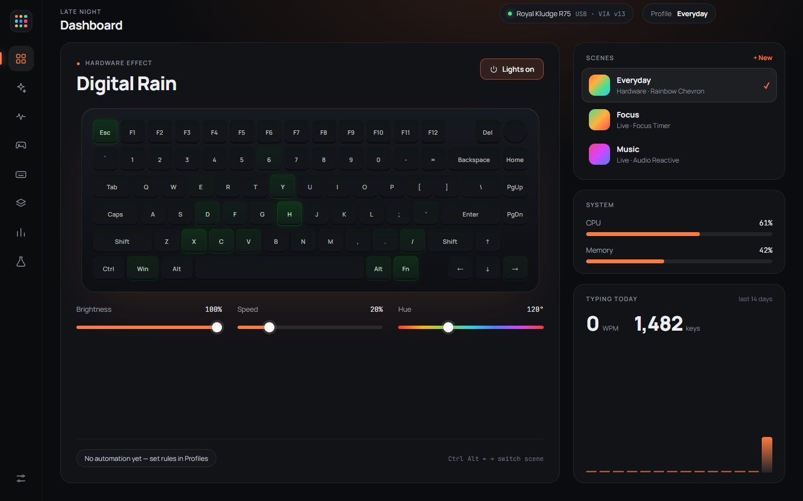
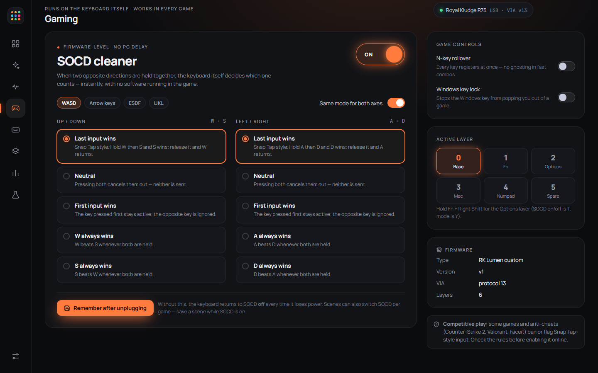
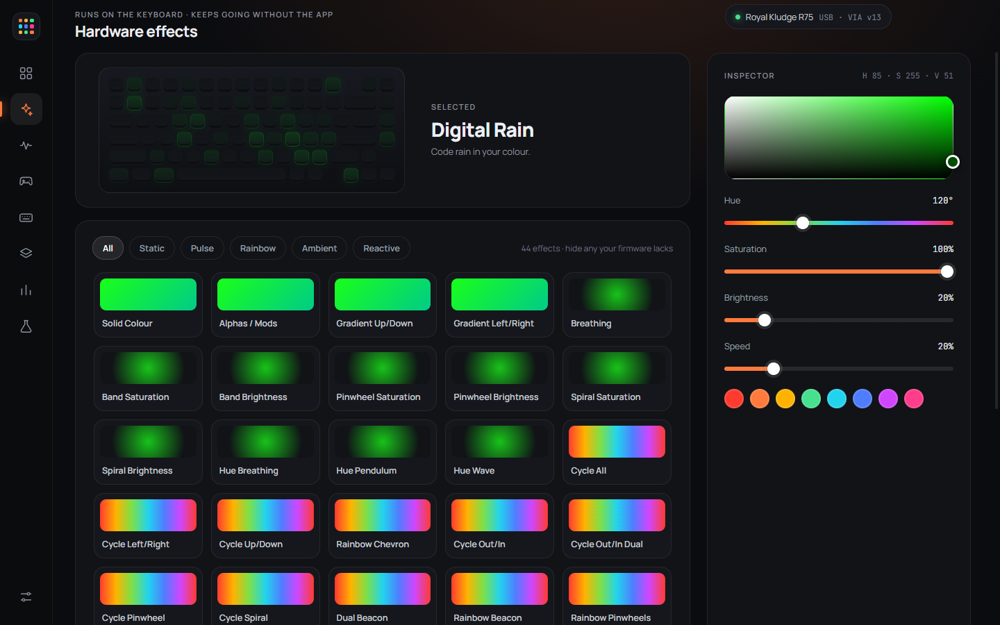

# RK Lumen

A modern Windows app for the **Royal Kludge R75** (wired, ANSI) — lighting, keymap, gaming (SOCD / Snap Tap) and automation — plus open-source **custom firmware** that lets the app control the keyboard's gaming features.

<p align="center"></p>

> **Status:** v1.0.0. Developed and tested on one keyboard: R75 wired ANSI, USB ID `342D:E484`. The ISO model (`342D:E483`) and other RK boards are **not tested** — do not flash them.

## What you get

**The app** (works with the stock firmware too)
- **Hardware effects:** all 44 built-in QMK RGB effects, hue / saturation / brightness / speed, "Save to keyboard".
- **Live effects (animated from the PC):** audio-reactive, screen ambience, CPU/RAM load, typing energy, focus timer, circadian glow, colour journey, breathing, rainbow.
- **Keymap editor:** all layers, keycode picker, modifier combos, knob press / turn left / turn right, backup and restore, reset to defaults.
- **Scenes and automation:** save lighting scenes, switch per application, idle dim / off, night schedule, lights off when the PC locks, global hotkeys, tray + start with Windows.
- **Insights (opt-in):** typing speed and a per-key heat-map. Only counts are stored, never what you type.
- **Updates inside the app:** the installed version checks GitHub releases, shows the release notes and updates itself when you click *Download* → *Restart & install*. Keyboard firmware is never updated automatically.
- **Protocol lab:** raw HID console for the VIA interface (dangerous commands are blocked).

**The firmware** (optional, adds the *Gaming* page)
- **SOCD cleaner in the keyboard itself:** last input wins (Snap Tap), neutral, first input wins, or a fixed winner; per axis; configurable key pairs (WASD, arrows, ESDF, IJKL).
- **N-key rollover** and **Windows-key lock** switches.
- Settings controllable from the app and **saved on the keyboard**; scenes can switch SOCD per game.
- Everything else of the community R75 firmware: VIA, 6 layers, knob, indicators.

<p align="center">
  
  
</p>

## Install

1. Download **`RK-Lumen-1.0.0-x64.exe`** from the [latest release](https://github.com/jamimmehdi/rk-lumen/releases/latest) and run it (or use the portable `.zip`).
   Windows SmartScreen may warn because the installer is not code-signed: choose *More info → Run anyway* if you trust this repository.
   The installed app updates itself from then on (Settings → Updates). The portable zip does not — replace its folder with the new version.
2. Plug in the keyboard over USB and open **RK Lumen**. Lighting, keymap, scenes and automation work immediately.
3. *(Optional)* Flash the custom firmware to unlock SOCD / N-key rollover / Windows-key lock — see **[firmware/README.md](firmware/README.md)** and read the warnings first.

## Safety, privacy, fair play

- **Flashing firmware can brick a keyboard.** It worked on the author's board; yours may differ. Read [firmware/README.md](firmware/README.md), take the backup the script offers, and only flash a wired R75 ANSI (`342D:E484`).
- **Competitive games:** Counter-Strike 2 bans Snap Tap-style input; Valorant, Faceit and others may flag or change rules. SOCD is **off by default**. You are responsible for following the rules of the games you play.
- **Privacy:** no telemetry and no accounts. The only network access is the optional update check against this repository's GitHub releases (Settings → Updates; it can be switched off). Settings live in `%APPDATA%\RK Lumen`. The optional key counter uses a local keyboard hook and is off until you enable it.

## Build from source

```bash
npm install
npm start            # builds the UI and launches Electron
npm run dist         # Windows installer + zip in ./release
```

Requires Node 20+ (developed on Node 24). Firmware build instructions are in [firmware/README.md](firmware/README.md).

## Repository layout

| Path | What |
| --- | --- |
| `src/` | React + TypeScript UI |
| `electron/` | Main process: HID/VIA transport, live-effect engine, automation, tray |
| `firmware/` | QMK keyboard definition (`rk/r75/custom`), build and flash scripts |
| `tools/` | Developer helpers (icon generator, read-only probes) |

## Credits and licences

- **App:** MIT — see [LICENSE](LICENSE).
- **Firmware:** GPL — see [firmware/LICENSE](firmware/LICENSE). Based on the community [Royal-Kludge-R75](https://github.com/snakkarike/Royal-Kludge-R75) project (credits: @sdk66, @iamdanielv, @irfanjmdn, @snakkarike), [QMK Firmware](https://github.com/qmk/qmk_firmware), and Pascal Getreuer's [SOCD Cleaner](https://getreuer.info/posts/keyboards/socd-cleaner) (Apache-2.0). Details in [NOTICE.md](NOTICE.md).
- Flashing uses Westberry's [wb32-dfu-updater](https://github.com/WestberryTech/wb32-dfu-updater) (Apache-2.0), downloaded at flash time.
- *Royal Kludge* and *RK* are trademarks of their owners. This project is not affiliated with or endorsed by them.
